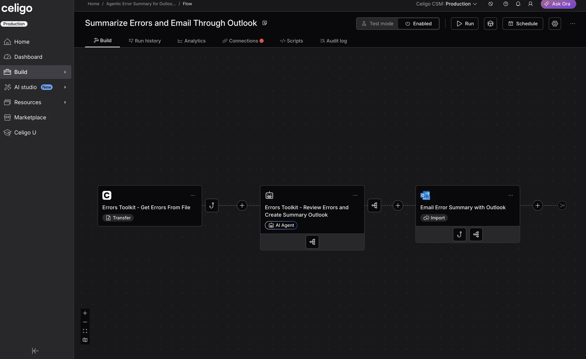

# Agentic Error Summary for Outlook



A Celigo integrator.io template that emails an AI-written summary of recent
flow errors to an Outlook inbox. Three chained flows list every flow step,
collect the recent open errors, and have an AI agent write and send the
summary.

> **NOTE**
> Every ID in this repo and in the zip is fake. None of them belong to a
> live integration, connection, flow, or account. The connections ship without
> credentials. You enter your own after the upload.

## Get started

1. Download [the zip](dist/agentic-error-summary-for-outlook.zip) and upload
   it to your integrator.io account.
2. Follow [INSTRUCTIONS.md](INSTRUCTIONS.md) to configure it.

## Repo layout

```bash
assets/           screenshot used in this README
dist/             importable zip
flows/            the three flows
exports/          flow sources
imports/          flow destinations and the AI agent
scripts/          hooks (each has a .js and a .json file)
connections/      connection templates with no credentials
integration.json  integration settings and the lookback form
INSTRUCTIONS.md   setup steps after the upload
```

The files in this repo are for reference. They contain configuration that
integrator.io does not recognize, so upload [the zip in `dist/`](dist/agentic-error-summary-for-outlook.zip)
instead of zipping them yourself.
